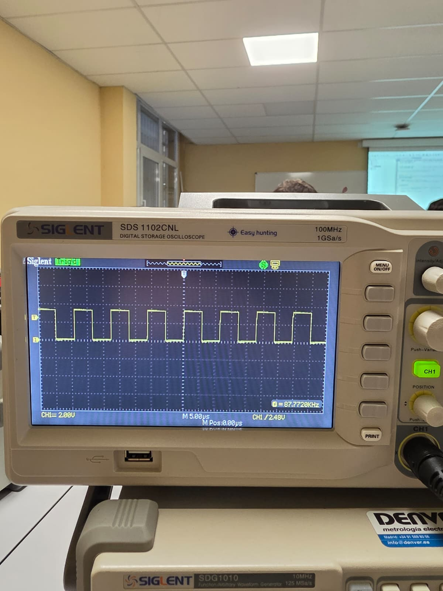
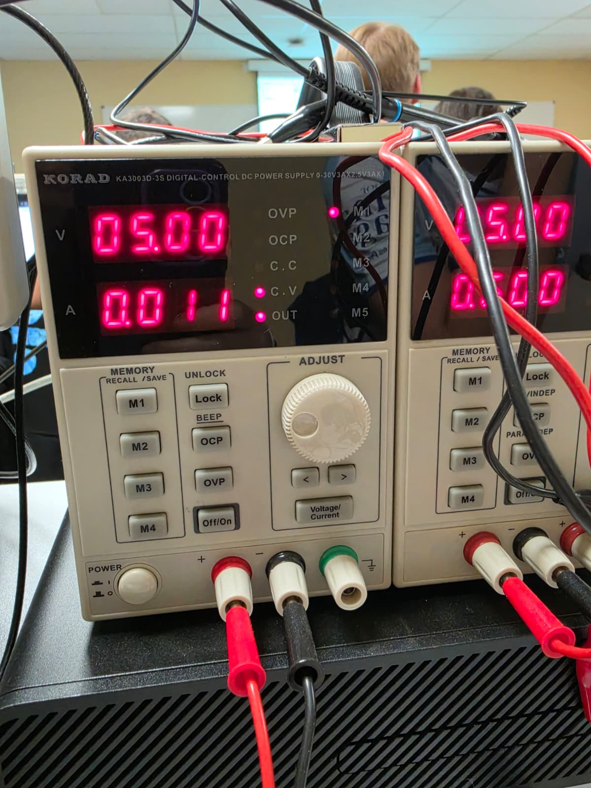
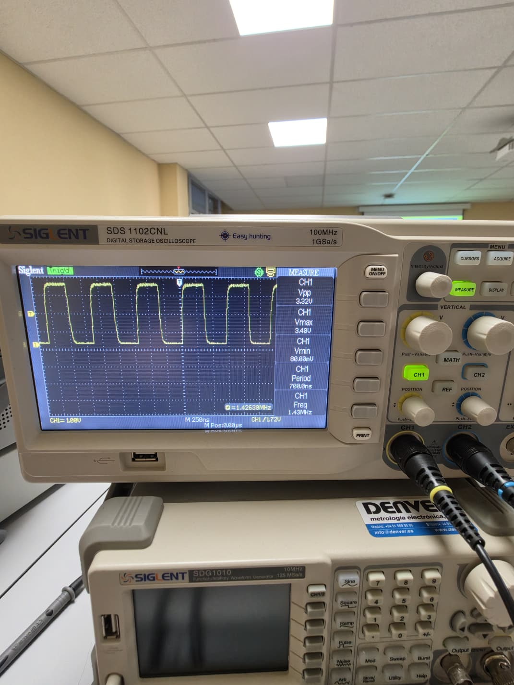
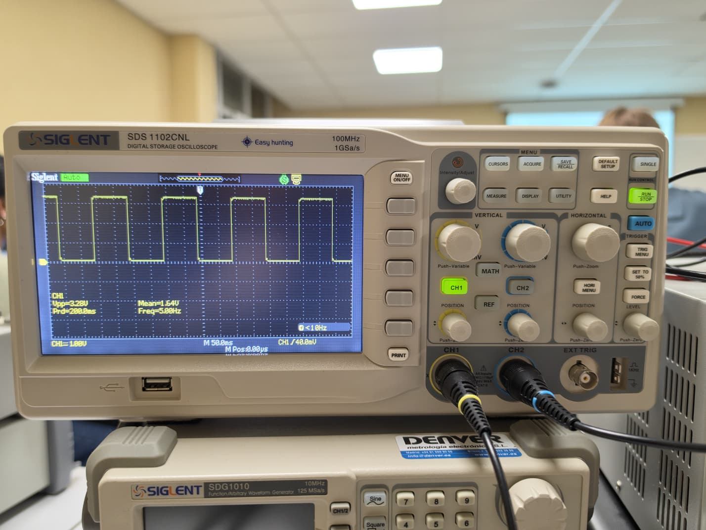
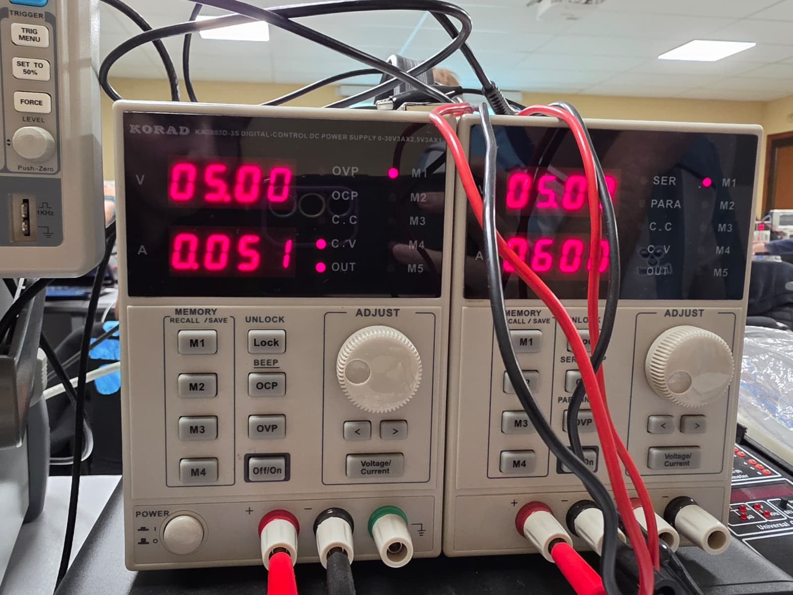
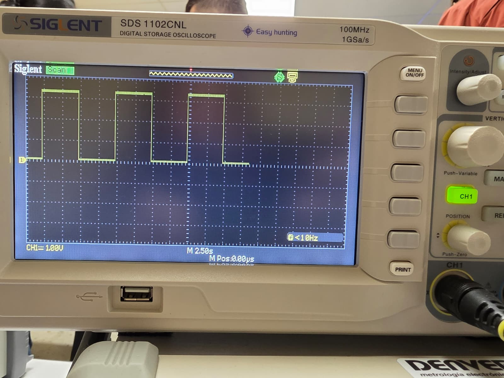
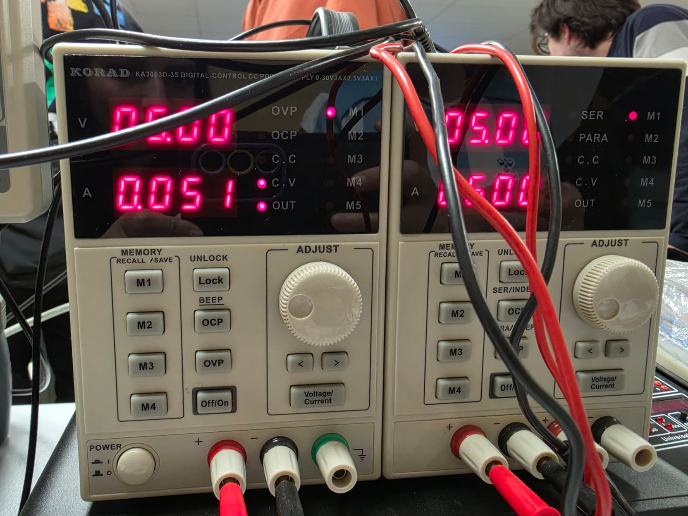

# Memoria de Prácticas: Sistemas Distribuidos

**Autor:**   
**Asignatura:** Sistemas Distribuidos  

---

## Índice
1. [Práctica 1: Entrada-salida](#práctica-1-entrada-salida)
2. [Práctica 2: Timers](#práctica-2-timers)

---

## Práctica 1: Entrada-salida
#### Inicialización y Configuración del Chip
```c
#pragma config ICS = PGD1               // ICD Communication Channel Select bits (Communicate on PGEC1 and PGED1)
#pragma config JTAGEN = OFF             // JTAG Enable bit (JTAG is disabled)

// FPOR
#pragma config BOREN = ON               //  (BOR is enabled)
#pragma config ALTI2C1 = OFF            // Alternate I2C1 pins (I2C1 mapped to SDA1/SCL1 pins)
#pragma config ALTI2C2 = OFF            // Alternate I2C2 pins (I2C2 mapped to SDA2/SCL2 pins)
#pragma config WDTWIN = WIN25           // Watchdog Window Select bits (WDT Window is 25% of WDT period)

// FWDT
#pragma config WDTPOST = PS32768        // Watchdog Timer Postscaler bits (1:32,768)
#pragma config WDTPRE = PR128           // Watchdog Timer Prescaler bit (1:128)
#pragma config PLLKEN = OFF             // PLL Lock Enable bit (Clock switch will not wait for the PLL lock signal.)
#pragma config WINDIS = OFF             // Watchdog Timer Window Enable bit (Watchdog Timer in Non-Window mode)
#pragma config FWDTEN = OFF             // Watchdog Timer Enable bit (Watchdog timer enabled/disabled by user software)

// FOSC
#pragma config POSCMD = XT              // Primary Oscillator Mode Select bits (XT Crystal Oscillator Mode)
#pragma config OSCIOFNC = OFF           // OSC2 Pin Function bit (OSC2 is clock output)
#pragma config IOL1WAY = OFF            // Peripheral pin select configuration (Allow multiple reconfigurations)
#pragma config FCKSM = CSDCMD           // Clock Switching Mode bits (Both Clock switching and Fail-safe Clock Monitor are disabled)

// FOSCSEL
#pragma config FNOSC = PRI              // Oscillator Source Selection (Primary Oscillator (XT, HS, EC))
#pragma config PWMLOCK = OFF            // PWM Lock Enable bit (PWM registers may be written without key sequence)
#pragma config IESO = OFF               // Two-speed Oscillator Start-up Enable bit (Start up with user-selected oscillator source)

// FGS
#pragma config GWRP = OFF               // General Segment Write-Protect bit (General Segment may be written)
#pragma config GCP = OFF                // General Segment Code-Protect bit (General Segment Code protect is Disabled)
```
### Primer apartado:
Debe construirse un programa que configure el sistema de reloj del sistema para trabajar a la frecuencia del cristal (7,3728MHz), haciendo que de forma indefinida cambie el estado del pin 8 del puerto B.
#### Código
```c
#include "xc.h"

void init_c_clock_signal()
{
    RCONbits.SWDTEN =0;
}

void init_ports()
{
    TRISBbits.TRISB8 = 0;
}

int main(void) 
{
    init_c_clock_signal();
    init_ports();
    
    
    while(1)
    {
         PORTBbits.RB8 = !LATBbits.LATB8;
    }
}
```
#### Resultados
<figure align="center">
  
  <figcaption><i>Figura 1: Resultado en osciloscopio práctica 1 ejercicio 1.</i></figcaption>
</figure>
<figure align="center">
  
  <figcaption><i>Figura 2: Alimentación en práctica 1 ejercicio 1.</i></figcaption>
</figure>

### Segundo apartado:
Debe modificarse el programa anterior para que active el sistema de multiplicación de frecuencia del cristal del micro para conseguir una frecuencia Fosc de 119.808 MHz.
#### Cálculo de parámetros del PLL

**Variables iniciales:**
Por tanteo:
* `PLLPOST = 0` $\rightarrow N_2 = 2$
* `PLLPRE = 0` $\rightarrow N_1 = 2$
Obtenido mediante enunciado:
* $F_{IN} = 7,3728$
* $F_{OSC} = 119,808$

**Desarrollo analítico:**
$$F_{OSC} = F_{IN} \times \left( \frac{M}{N_1 \times N_2} \right)$$
$$119,808 = 7,3728 \times \left( \frac{M}{4} \right)$$
$$M = \frac{119,808 \times 4}{7,3728} = 65$$
$$PLLDIV = M - 2 = 63$$
#### Código
```c
#include "xc.h"

void init_clock_signal(void)
{
    RCONbits.SWDTEN = 0; // Disable Watchdog Timer
    PLLFBDbits.PLLDIV = 63; // M = PLLDIV + 2 = XX -> PLLDIV = XX - 2 = XX
    CLKDIVbits.PLLPOST = 0; // N2 = X (Output/2)
    CLKDIVbits.PLLPRE = 0; // N1 = X (Input/2)
    
    // clock switching to incorporate PLL
    __builtin_write_OSCCONH(0x03); // Initiate Clock Switch to Primary
    __builtin_write_OSCCONL(0x01); // Start clock switching

    while (OSCCONbits.COSC != 0b011); // Wait for Clock switch to occur
    while (OSCCONbits.LOCK != 1); // Wait for PLL to lock (If LOCK = 1 -> PLL start-up timer is satisfied)

}

void init_ports()
{
    TRISBbits.TRISB8 = 0;
}

int main(void) 
{
    init_clock_signal();
    init_ports();
    
    
    while(1)
    {
         PORTBbits.RB8 = !LATBbits.LATB8;
    }
}
```
#### Pruebas y Resultados
<figure align="center">
  
  <figcaption><i>Figura 3: Resultado en osciloscopio práctica 1 ejercicio 2.</i></figcaption>
</figure>

## Práctica 2: Timers
#### Inicialización y Configuración del Chip
```c
// FICD
#pragma config ICS = PGD1               // ICD Communication Channel Select bits (Communicate on PGEC1 and PGED1)
#pragma config JTAGEN = OFF             // JTAG Enable bit (JTAG is disabled)

// FPOR
#pragma config BOREN = ON               //  (BOR is enabled)
#pragma config ALTI2C1 = OFF            // Alternate I2C1 pins (I2C1 mapped to SDA1/SCL1 pins)
#pragma config ALTI2C2 = OFF            // Alternate I2C2 pins (I2C2 mapped to SDA2/SCL2 pins)
#pragma config WDTWIN = WIN25           // Watchdog Window Select bits (WDT Window is 25% of WDT period)

// FWDT
#pragma config WDTPOST = PS32768        // Watchdog Timer Postscaler bits (1:32,768)
#pragma config WDTPRE = PR128           // Watchdog Timer Prescaler bit (1:128)
#pragma config PLLKEN = OFF             // PLL Lock Enable bit (Clock switch will not wait for the PLL lock signal.)
#pragma config WINDIS = OFF             // Watchdog Timer Window Enable bit (Watchdog Timer in Non-Window mode)
#pragma config FWDTEN = OFF             // Watchdog Timer Enable bit (Watchdog timer enabled/disabled by user software)

// FOSC
#pragma config POSCMD = XT              // Primary Oscillator Mode Select bits (XT Crystal Oscillator Mode)
#pragma config OSCIOFNC = OFF           // OSC2 Pin Function bit (OSC2 is clock output)
#pragma config IOL1WAY = OFF            // Peripheral pin select configuration (Allow multiple reconfigurations)
#pragma config FCKSM = CSECMD           // Clock Switching Mode bits (Both Clock switching and Fail-safe Clock Monitor are disabled)

// FOSCSEL
#pragma config FNOSC = PRI              // Oscillator Source Selection (Primary Oscillator (XT, HS, EC))
#pragma config PWMLOCK = OFF            // PWM Lock Enable bit (PWM registers may be written without key sequence)
#pragma config IESO = OFF               // Two-speed Oscillator Start-up Enable bit (Start up with user-selected oscillator source)

// FGS
#pragma config GWRP = OFF               // General Segment Write-Protect bit (General Segment may be written)
#pragma config GCP = OFF                // General Segment Code-Protect bit (General Segment Code protect is Disabled)
```
### Primer apartado:
Debe configurarse el timer 1 para que genere una interrupción cada 100 ms. Cada vez que se active la interrupción debe cambiarse el estado del pin 8 del puerto B.
#### Código
```c
#include "xc.h"

void init_clock_signal(void)
{
    RCONbits.SWDTEN = 0; // Disable Watchdog Timer

    PLLFBDbits.PLLDIV = 63; // M = PLLDIV + 2 = XX -> PLLDIV = XX - 2 = XX
    CLKDIVbits.PLLPOST = 0; // N2 = X (Output/2)
    CLKDIVbits.PLLPRE = 0; // N1 = X (Input/2)
    
    // clock switching to incorporate PLL
    __builtin_write_OSCCONH(0x03); // Initiate Clock Switch to Primary
    __builtin_write_OSCCONL(0x01); // Start clock switching

    while (OSCCONbits.COSC != 0b011); // Wait for Clock switch to occur
    while (OSCCONbits.LOCK != 1); // Wait for PLL to lock (If LOCK = 1 -> PLL start-up timer is satisfied)

}

void init_ports()
{
    TRISBbits.TRISB8 = 0;
}

void init_t1()
{
    TMR1 = 0; //PROBLEMA SIMULADOR - no necesario
    T1CONbits.TSIDL = 1;
    T1CONbits.TGATE = 0;
    T1CONbits.TCS = 0;
    T1CONbits.TCKPS = 0b11;
    
    PR1 = 23400;
    
    IPC0bits.T1IP = 7;
    IFS0bits.T1IF = 0;
    IEC0bits.T1IE = 1;
    T1CONbits.TON = 1;
}

int main(void) 
{
    init_clock_signal();
    init_ports();
    init_t1();
    
    while(1);
}

void __attribute__((interrupt(no_auto_psv))) _T1Interrupt(void)
{
    PORTBbits.RB8 = !LATBbits.LATB8;
    IFS0bits.T1IF = 0;
}
```
#### Resultados
<figure align="center">
  
  <figcaption><i>Figura 1: Resultado en osciloscopio práctica 2 ejercicio 1.</i></figcaption>
</figure>
<figure align="center">
  
  <figcaption><i>Figura 2: Alimentación en práctica 2 ejercicio 1.</i></figcaption>
</figure>

### Segundo apartado:
Deben configurarse los timers 4 y 5 para que trabajen de forma conjunta, debiendo generar una interrupción cada 5s. Cada vez que se active la interrupción debe cambiarse el estado del pin 8 del puerto B.
#### Código
```c
#include "xc.h"

void init_clock_signal(void)
{
    RCONbits.SWDTEN = 0; // Disable Watchdog Timer

    PLLFBDbits.PLLDIV = 63; // M = PLLDIV + 2 = XX -> PLLDIV = XX - 2 = XX
    CLKDIVbits.PLLPOST = 0; // N2 = X (Output/2)
    CLKDIVbits.PLLPRE = 0; // N1 = X (Input/2)
    
    // clock switching to incorporate PLL
    __builtin_write_OSCCONH(0x03); // Initiate Clock Switch to Primary
    __builtin_write_OSCCONL(0x01); // Start clock switching

    while (OSCCONbits.COSC != 0b011); // Wait for Clock switch to occur
    while (OSCCONbits.LOCK != 1); // Wait for PLL to lock (If LOCK = 1 -> PLL start-up timer is satisfied)

}

void init_ports()
{
    TRISBbits.TRISB8 = 0;
}

void init_t1()
{
    //TMR4 = 0; //PROBLEMA SIMULADOR - no necesario
    T4CONbits.TSIDL = 1;
    T4CONbits.TGATE = 0;
    T4CONbits.TCS = 0;
    T4CONbits.TCKPS = 0b11;
    T4CONbits.T32 = 1;
    
    PR4 = 0xDC00;
    PR5 = 0x0011;
    
    IPC7bits.T5IP = 7;
    IFS1bits.T5IF = 0;
    IEC1bits.T5IE = 1;
    T4CONbits.TON = 1;
}

int main(void) 
{
    init_clock_signal();
    init_ports();
    init_t1();
    
    while(1);
}

void __attribute__((interrupt(no_auto_psv))) _T5Interrupt(void)
{
     LATBbits.LATB8 = !LATBbits.LATB8;
    IFS1bits.T5IF = 0;
}
```
#### Resultados
<figure align="center">
  
  <figcaption><i>Figura 4: Resultado en osciloscopio práctica 2 ejercicio 2.</i></figcaption>
</figure>
<figure align="center">
  
  <figcaption><i>Figura 5: Alimentación en práctica 2 ejercicio 2.</i></figcaption>
</figure>


